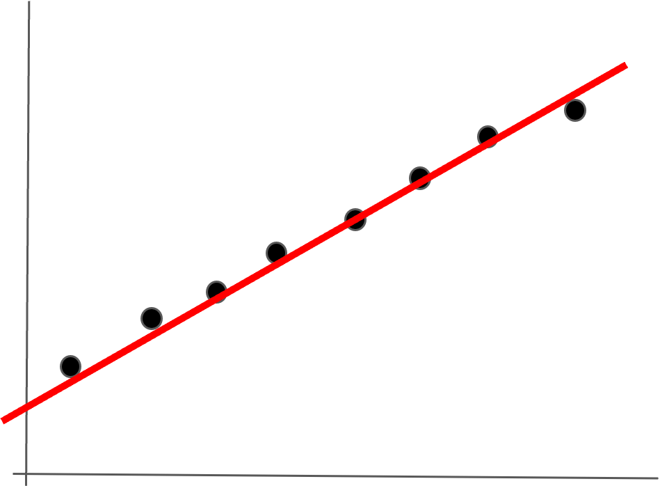
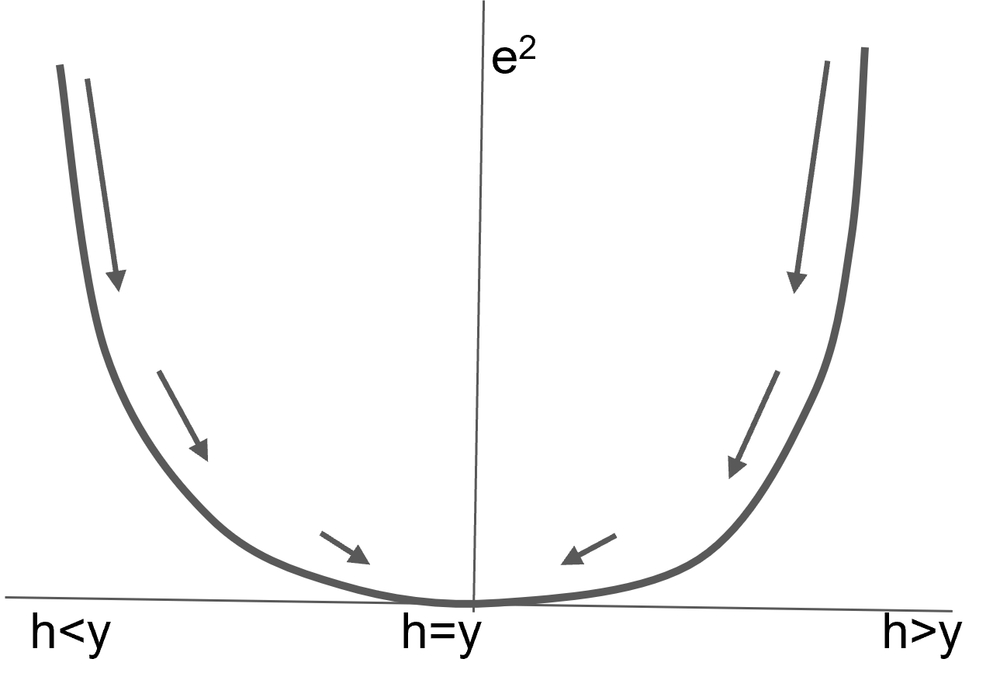
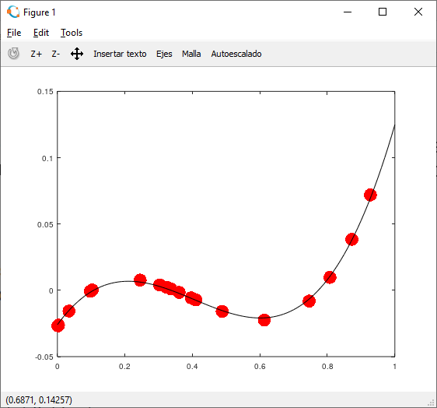
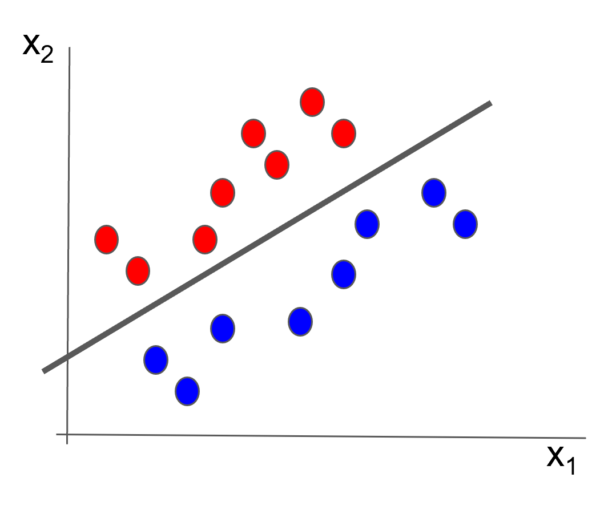
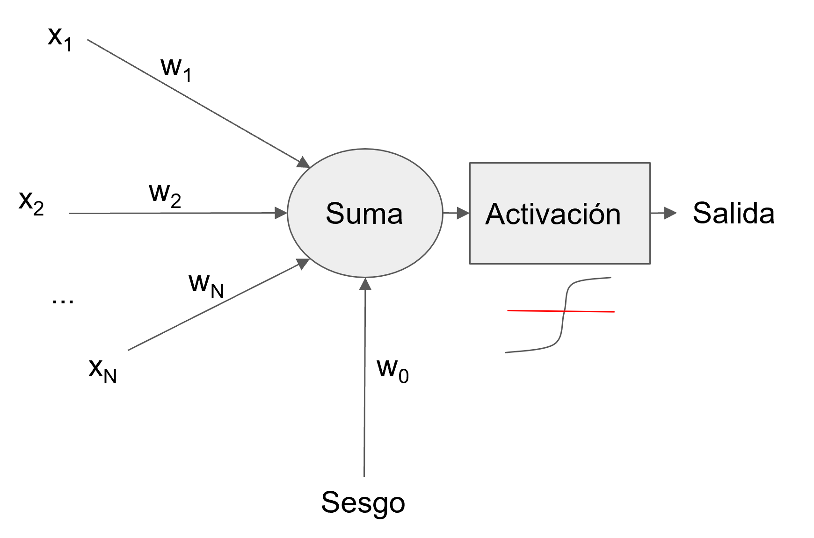

# Neurona artificial y descenso del gradiente

**Material de clase — Inteligencia Artificial**  
Basado en la presentación *01 Neurona Artificial.pptx* y las cinco figuras proporcionadas.

## 1. Ajuste de una hipótesis mediante descenso del gradiente

Disponemos de observaciones $(x_i,y_i)$ y proponemos una hipótesis lineal:

$$h(x)=w_1x+w_0$$

La diferencia entre el valor real y el estimado es $e=y-h(x)$. Utilizamos el error cuadrático:

$$E=(y-h)^2=e^2.$$

Su derivada respecto a la salida de la hipótesis es:

$$\frac{\partial E}{\partial h}=-2(y-h)=2(h-y).$$

### 1.1. Gradientes respecto a los parámetros

Aplicando la regla de la cadena:

$$\frac{\partial E}{\partial w_1}=\frac{\partial E}{\partial h}\frac{\partial h}{\partial w_1}=2(h-y)x=-2ex$$

$$\frac{\partial E}{\partial w_0}=\frac{\partial E}{\partial h}\frac{\partial h}{\partial w_0}=2(h-y)=-2e.$$

La actualización de los pesos, con tasa de aprendizaje $\eta>0$, es:

$$w_1\leftarrow w_1-\eta\frac{\partial E}{\partial w_1},\qquad w_0\leftarrow w_0-\eta\frac{\partial E}{\partial w_0}.$$

Por tanto:

$$w_1\leftarrow w_1+2\eta ex,\qquad w_0\leftarrow w_0+2\eta e.$$

> **Nota:** La presentación original escribe las actualizaciones sin una tasa de aprendizaje explícita; eso equivale a $\eta=1$. En la práctica, se elige una tasa apropiada para controlar la convergencia.

## 2. Interpretación geométrica del error

El descenso del gradiente modifica los parámetros en la dirección opuesta al gradiente de la función de pérdida. Para una función convexa, como el error cuadrático de un modelo lineal, el objetivo es acercarse a un mínimo global.

Para un conjunto de $m$ observaciones puede utilizarse el error cuadrático medio:

$$J(\mathbf w)=\frac{1}{m}\sum_{i=1}^{m}(y_i-h(\mathbf x_i))^2.$$

Su gradiente es el promedio de las contribuciones individuales. Puede calcularse sobre todos los datos (*batch*), una observación a la vez (*estocástico*) o pequeños lotes (*mini-batch*).

## 3. Extensión a una hipótesis polinómica

Para una función cúbica:

$$h(x)=w_3x^3+w_2x^2+w_1x+w_0.$$

Con $e=y-h(x)$, las derivadas del error cuadrático son:

$$\frac{\partial E}{\partial w_3}=-2ex^3,\quad \frac{\partial E}{\partial w_2}=-2ex^2,$$

$$\frac{\partial E}{\partial w_1}=-2ex,\quad \frac{\partial E}{\partial w_0}=-2e.$$

En general, para $h(x)=\sum_{j=0}^{n}w_jx^j$:

$$\frac{\partial E}{\partial w_j}=-2ex^j,\qquad w_j\leftarrow w_j+2\eta ex^j.$$

## 4. Clasificación lineal y perceptrón

Ahora consideramos un problema de clasificación binaria: puntos rojos etiquetados como $+1$ y puntos azules etiquetados como $-1$.

Se propone la combinación lineal:

$$z=w_0+w_1x_1+w_2x_2.$$

La frontera de decisión corresponde a $z=0$. Con una activación escalón bipolar, la predicción es $\hat y=+1$ si $z\geq 0$ y $\hat y=-1$ en caso contrario.

Si se utiliza **error cuadrático sobre la salida lineal** $h=z$, entonces:

$$\frac{\partial E}{\partial w_2}=-2ex_2,\qquad \frac{\partial E}{\partial w_1}=-2ex_1,\qquad \frac{\partial E}{\partial w_0}=-2e.$$

**Distinción importante:** el algoritmo clásico del perceptrón de Rosenblatt no obtiene sus actualizaciones derivando el escalón, que no es diferenciable en el umbral. Actualiza los pesos cuando una muestra está mal clasificada:

$$\mathbf w\leftarrow\mathbf w+\eta y\mathbf x,\qquad b\leftarrow b+\eta y,$$

para etiquetas $y\in\{-1,+1\}$ y entradas aumentadas según la convención adoptada.

## 5. Neurona artificial y funciones de activación

Una neurona artificial calcula primero una suma ponderada:

$$z=w_0+\sum_{j=1}^{N}w_jx_j.$$

Posteriormente aplica una función de activación $a=f(z)$.

### 5.1. Sigmoide logística

$$\sigma(z)=\frac{1}{1+e^{-z}},\qquad 0<\sigma(z)<1.$$

Su derivada es:

$$\sigma'(z)=\sigma(z)\bigl(1-\sigma(z)\bigr).$$

### 5.2. Tangente hiperbólica

La activación bipolar puede expresarse mediante:

$$\tanh(z)=2\sigma(2z)-1=\frac{1-e^{-2z}}{1+e^{-2z}},\qquad -1<\tanh(z)<1.$$

De forma más general, $2\sigma(kz)-1=\tanh(kz/2)$. La derivada de la tangente hiperbólica es:

$$\frac{d}{dz}\tanh(z)=1-\tanh^2(z).$$

## 6. Función de pérdida de entropía cruzada

Para clasificación binaria con etiquetas $y\in\{0,1\}$ y salida sigmoidal $a=\sigma(z)$, la pérdida por observación es:

$$L(y,a)=-y\ln(a)-(1-y)\ln(1-a).$$

La derivada respecto a la salida $a$ es:

$$\frac{\partial L}{\partial a}=-\frac{y}{a}+\frac{1-y}{1-a}.$$

Por la regla de la cadena y la derivada de la sigmoide:

$$\frac{\partial L}{\partial z}=\frac{\partial L}{\partial a}\frac{\partial a}{\partial z}=a-y.$$

Por consiguiente, los gradientes de los pesos son:

$$\frac{\partial L}{\partial w_j}=(a-y)x_j,\qquad \frac{\partial L}{\partial w_0}=a-y.$$

Las actualizaciones con descenso del gradiente son:

$$w_j\leftarrow w_j-\eta(a-y)x_j,\qquad w_0\leftarrow w_0-\eta(a-y).$$

## 7. Comparación de enfoques

| Enfoque | Salida | Función de pérdida / criterio | Actualización |
|---|---|---|---|
| Regresión lineal o polinómica | Continua | Error cuadrático | Gradiente de la pérdida |
| Perceptrón de Rosenblatt | Clase $-1$ o $+1$ | Error de clasificación | Solo para ejemplos mal clasificados |
| Neurona sigmoidal | Probabilidad en $(0,1)$ | Entropía cruzada binaria | Gradiente de la pérdida |

## 8. Actividades sugeridas

1. Calcular manualmente una iteración de descenso del gradiente para una observación y una hipótesis lineal.
2. Repetir el cálculo para un modelo cúbico y comparar los gradientes de cada coeficiente.
3. Implementar el perceptrón de Rosenblatt para separar dos clases linealmente separables.
4. Comparar el comportamiento de la activación escalón, la sigmoide logística y la tangente hiperbólica.
5. Derivar y programar la actualización de pesos usando entropía cruzada binaria.

## Referencias y material de origen

- Presentación proporcionada: *01 Neurona Artificial.pptx* (6 diapositivas).
- Figuras proporcionadas: `curva.png`, `error-cuadratico(1).png`, `perceptron(1).png`, `puntos-linea.png`, `separacion-lineal.png`.
- Hastie, T., Tibshirani, R., & Friedman, J. (2009). *The Elements of Statistical Learning: Data Mining, Inference, and Prediction* (2.ª ed., impresión corregida de 2017). Springer. PDF proporcionado como bibliografía complementaria.

*Se normalizó la notación matemática y se aclararon diferencias entre el descenso del gradiente, el perceptrón clásico y la clasificación con sigmoide.*
