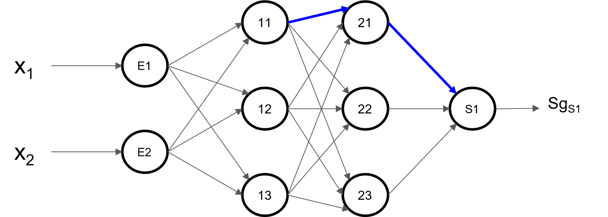
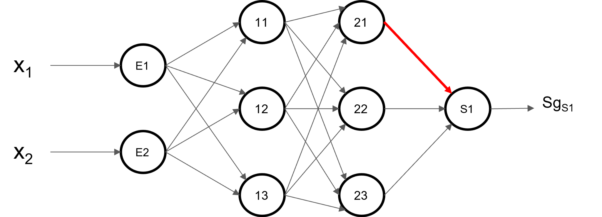
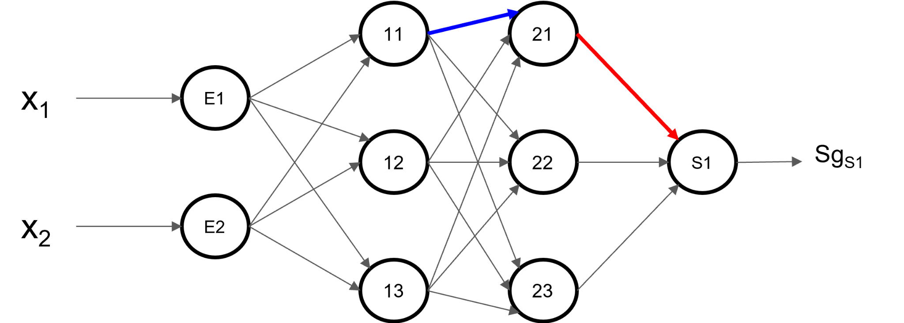
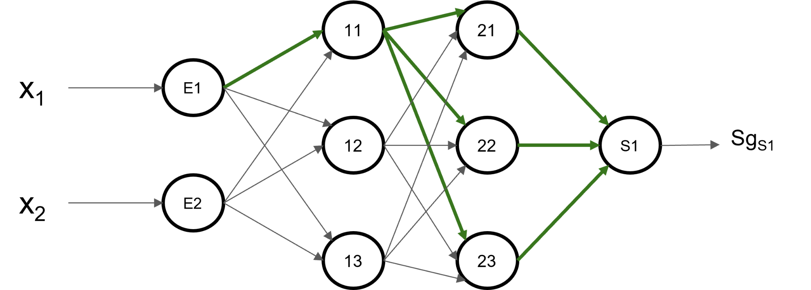

# Redes neuronales artificiales multicapa (MLP)

**Inteligencia Artificial — Universidad del Norte**  
**Material docente:** Eduardo Zurek, Ph.D.  
**Tema:** Arquitectura, propagación hacia adelante, descenso del gradiente y retropropagación.

## 1. Objetivos de aprendizaje

Al finalizar, el estudiante podrá identificar las capas de un perceptrón multicapa, calcular la salida de sus neuronas, definir una función de pérdida y obtener las derivadas necesarias para actualizar los pesos mediante *backpropagation*.

## 2. Arquitectura de una red multicapa

.png)

Una red neuronal multicapa (*multilayer perceptron*, MLP) se compone de una **capa de entrada**, una o varias **capas ocultas** y una **capa de salida**. La capa de entrada representa las variables observadas; no realiza por sí misma el cálculo de activación de una neurona. Cada neurona de las capas siguientes recibe valores de la capa anterior, los combina mediante pesos y un sesgo (*bias*) y aplica una función de activación.

En las figuras, $E1$ y $E2$ designan entradas. El sesgo de cada neurona está implícito. Se utiliza la convención **$w_{j,i}$: peso de la conexión que va de la neurona $i$ a la neurona $j$**.

Para una neurona $j$:

$$
Sm_j=\sum_i w_{j,i}Sg_i+b_j,\qquad Sg_j=f(Sm_j).
$$

- $Sm$: suma ponderada o potencial previo a la activación.
- $Sg$: salida después de la función de activación.
- $b_j$: sesgo de la neurona $j$.

Cuando se usa la función sigmoidal:

$$
\sigma(z)=\frac{1}{1+e^{-z}},\qquad \sigma'(z)=\sigma(z)(1-\sigma(z)).
$$

## 3. Propagación hacia adelante (*forward propagation*)

Para la neurona $21$ de la segunda capa oculta, usando las conexiones del ejemplo:

$$
Sm_{21}=w_{21,11}Sg_{11}+w_{21,12}Sg_{12}+w_{21,13}Sg_{13}+b_{21}
$$

$$
Sg_{21}=\sigma(Sm_{21}).
$$

La salida de la neurona final $S1$ se obtiene a partir de las activaciones de la última capa oculta:

$$
Sm_{S1}=w_{S1,21}Sg_{21}+w_{S1,22}Sg_{22}+w_{S1,23}Sg_{23}+b_{S1}
$$

$$
\hat y=Sg_{S1}=\sigma(Sm_{S1}).
$$

Los términos de sesgo se muestran explícitamente aquí, aunque se omiten en algunas ecuaciones de la presentación original para simplificar la notación.

## 4. Error y función de pérdida

Para un ejemplo de entrenamiento con valor esperado $y$ y predicción $\hat y$:

$$
e=y-\hat y,\qquad L=e^2=(y-\hat y)^2.
$$

El objetivo del entrenamiento es ajustar los pesos y sesgos para reducir la pérdida. Para múltiples observaciones puede utilizarse el promedio de las pérdidas. En clasificación también es habitual utilizar **entropía cruzada** (*log loss*), cuya derivada difiere de la correspondiente al error cuadrático.

## 5. Descenso del gradiente

Cada parámetro se actualiza en la dirección opuesta al gradiente de la pérdida:

$$
w_{j,i}^{(t+1)}=w_{j,i}^{(t)}-\eta\frac{\partial L}{\partial w_{j,i}},
$$

siendo $\eta>0$ la tasa de aprendizaje. De manera análoga:

$$
b_j^{(t+1)}=b_j^{(t)}-\eta\frac{\partial L}{\partial b_j}.
$$

El gradiente se obtiene mediante la **regla de la cadena**, que permite descomponer el efecto de un peso sobre la pérdida a través de las neuronas intermedias.

## 6. Retropropagación: peso de la segunda capa oculta

Consideremos el peso $w_{21,11}$, que conecta la neurona $11$ con la neurona $21$. Para determinar su efecto sobre la pérdida se sigue la ruta desde la salida hasta dicho peso:

$$
\frac{\partial L}{\partial w_{21,11}}=
\frac{\partial L}{\partial Sg_{S1}}
\frac{\partial Sg_{S1}}{\partial Sm_{S1}}
\frac{\partial Sm_{S1}}{\partial Sg_{21}}
\frac{\partial Sg_{21}}{\partial Sm_{21}}
\frac{\partial Sm_{21}}{\partial w_{21,11}}.
$$

Las derivadas parciales son:

$$
\frac{\partial L}{\partial Sg_{S1}}=-2e,
\quad \frac{\partial Sg_{S1}}{\partial Sm_{S1}}=\sigma'(Sm_{S1}),
\quad \frac{\partial Sm_{S1}}{\partial Sg_{21}}=w_{S1,21},
$$

$$
\frac{\partial Sg_{21}}{\partial Sm_{21}}=\sigma'(Sm_{21}),
\quad \frac{\partial Sm_{21}}{\partial w_{21,11}}=Sg_{11}.
$$

Por tanto:

$$
\boxed{\frac{\partial L}{\partial w_{21,11}}=-2e\,\sigma'(Sm_{S1})\,w_{S1,21}\,\sigma'(Sm_{21})\,Sg_{11}}
$$

Esta expresión muestra que el error se transmite hacia atrás a través de los factores locales de la red. La figura siguiente destaca otra conexión de la misma capa, que se analiza de forma análoga.

## 7. Retropropagación: peso de la primera capa oculta

Un peso de una capa anterior puede influir en la salida por **varias rutas**. Por ello, sus contribuciones deben **sumarse** antes de continuar propagando el gradiente.

Para $w_{11,E1}$, con tres neuronas $21$, $22$ y $23$ en la capa siguiente:

$$
\begin{aligned}
\frac{\partial L}{\partial w_{11,E1}}={}&-2e\,\sigma'(Sm_{S1})\Big[
 w_{S1,21}\sigma'(Sm_{21})w_{21,11}\\
&+w_{S1,22}\sigma'(Sm_{22})w_{22,11}\\
&+w_{S1,23}\sigma'(Sm_{23})w_{23,11}
\Big]\sigma'(Sm_{11})Sg_{E1}.
\end{aligned}
$$

Esta fórmula supone la arquitectura y las conexiones representadas en las figuras, una sola neurona de salida, activaciones sigmoidales y pérdida cuadrática sin factor $1/2$.

## 8. Forma general del algoritmo *backpropagation*

Se define el término de error local de cada neurona como:

$$
\delta_j=\frac{\partial L}{\partial Sm_j}.
$$

Para una neurona de salida con pérdida cuadrática:

$$
\delta_{S1}=-2(y-\hat y)f'(Sm_{S1}).
$$

Para una neurona oculta $j$, conectada a neuronas $k$ de la capa siguiente:

$$
\boxed{\delta_j=f'(Sm_j)\sum_k w_{k,j}\delta_k.}
$$

Una vez conocidos los términos locales:

$$
\boxed{\frac{\partial L}{\partial w_{j,i}}=\delta_j Sg_i,\qquad
\frac{\partial L}{\partial b_j}=\delta_j.}
$$

Así, el procedimiento general es:

1. Inicializar pesos y sesgos.
2. Calcular todas las sumas ponderadas y activaciones de entrada a salida.
3. Evaluar la pérdida.
4. Calcular los términos $\delta$ de la capa de salida.
5. Propagar los términos $\delta$ hacia las capas anteriores.
6. Calcular gradientes de pesos y sesgos.
7. Actualizar parámetros y repetir durante el entrenamiento.

## 9. Consideraciones prácticas

- **Funciones de activación:** la sigmoidal permite explicar las derivadas, pero ReLU y otras activaciones son comunes en redes modernas.
- **Inicialización:** pesos demasiado grandes o pequeños pueden dificultar la propagación del gradiente.
- **Escalamiento de variables:** la normalización o estandarización de entradas suele favorecer el entrenamiento.
- **Sobreajuste:** evaluar con datos de validación; considerar regularización L1/L2 y parada temprana.
- **Optimización:** además del descenso del gradiente básico existen SGD con momento, Adam y L-BFGS.
- **Elección de pérdida:** depende de si el problema es de regresión, clasificación binaria o clasificación multiclase.

## 10. Actividades propuestas

1. Identificar las capas y contar los pesos y sesgos de la arquitectura ilustrada.
2. Calcular $Sm$ y $Sg$ para una neurona utilizando pesos y entradas elegidos.
3. Derivar el gradiente de $w_{21,12}$ por la regla de la cadena.
4. Explicar por qué el gradiente de $w_{11,E1}$ contiene una suma de tres términos.
5. Comparar la actualización de un peso con dos tasas de aprendizaje diferentes.
6. Implementar una red pequeña y contrastar el gradiente analítico con una aproximación por diferencias finitas.

## 11. Referencias y procedencia

- Eduardo Zurek. **Redes Neuronales Artificiales Multicapa**. Presentación de clase, Inteligencia Artificial, Universidad del Norte (archivo proporcionado).
- Hastie, T., Tibshirani, R. y Friedman, J. **The Elements of Statistical Learning: Data Mining, Inference, and Prediction**, 2.ª edición, Springer. Capítulo 11, *Neural Networks*, especialmente §§11.3–11.5 (PDF de referencia proporcionado).
- Figuras de la red neuronal y rutas de propagación: cinco archivos PNG proporcionados junto con la presentación.

> **Nota de notación:** en la presentación se escribe $Sg'$ para la derivada de la función de activación. Aquí se expresa como $f'(Sm)$ o $\sigma'(Sm)$ para hacer explícito el argumento de la derivada. Las expresiones incluyen sesgos cuando corresponde.
