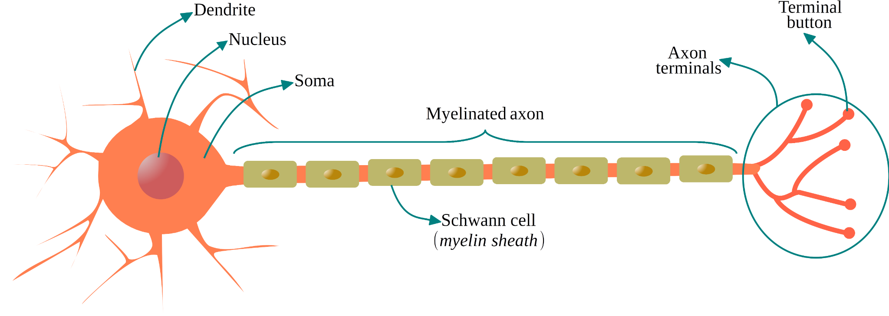
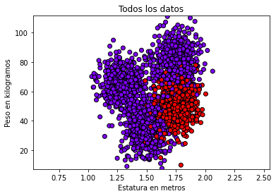

# Redes Neuronales Artificiales con ScikitLearn

> Conversión de la presentación original a Markdown. Se conserva el orden de las 14 diapositivas y sus enlaces originales. Los esquemas se representan en texto y notación matemática.

---

## 1. Redes Neuronales Artificiales con ScikitLearn

por Eduardo Zurek, Ph.D.  
Profesor Titular ezurek@uninorte.edu.co  
Departamento de Ingeniería de Sistemas  
Universidad del Norte

---

## 2. ¿Qué es una Red Neuronal Artificial?

Es una técnica biomimética (inspirada en sistemas biológicos) de aprendizaje computacional. Las neuronas artificiales se inspiran fundamentalmente en las neuronas multipolares.

---

## 3. ¿Cómo funciona una Neurona biológica?

Las neuronas multipolares comúnmente reciben señales a través de las dendritas y propagan señales a través del axón y posteriormente a través de las terminales axonales que hacen sinapsis con las dendritas de otras neuronas

La forma más común de transmitir información a través del espacio que existe entre una terminal axonal y una dendrita es mediante la difusión de unas sustancias químicas llamadas neurotransmisores, este fenómeno se conoce como sinapsis química

---

## 4. ¿Cómo funciona una Neurona biológica?

Los neurotransmisores abren compuertas moleculares en las dendritas que permiten el flujo de partículas cargadas eléctricamente llamadas iones.

Los iones crean una diferencia de voltaje entre el interior del cuerpo de la neurona y el medio ambiente externo, esa diferencia de voltaje se llama nivel de activación o potencial de membrana de la neurona

---

## 5. ¿Cómo funciona una Neurona biológica?

Las señales que llegan a través de las dendritas se combinan dentro de la neurona

En muchos modelos computacionales se supone que la combinación es una suma ponderada, pero también es posible describir la relación usando funciones lógicas booleanas

Una neurona propaga una señal eléctrica a través de su axón cuando el nivel de activación en su membrana es mayor que un umbral (propio de cada tipo de neurona)

La descarga eléctrica de la neurona se llama potencial de acción

---

## 6. Neurona Multipolar

Fuente: scientificstock.com

---

## 7. Neurona Artificial & Neurona Biológica

### Perceptrón

- Entradas: $x_1, x_2, \ldots, x_N$.
- Pesos: $w_1, w_2, \ldots, w_N$.
- Sesgo: $w_0$.
- Operaciones: suma ponderada, activación y salida.

$$
s = w_0 + \sum_{i=1}^{N} w_i x_i
$$

$$
\text{Salida} = f(s)
$$

*Representación matemática del esquema de la diapositiva.*

---

## 8. Descenso del Gradiente

Tenemos un conjunto de datos, y suponemos que ese conjunto de datos es explicado por una hipótesis.

Para este caso proponemos la hipótesis:

$$
h(x) = w_1 x + w_0
$$

Esta hipótesis implica un error respecto al valor verdadero que se está estimando. Por conveniencia matemática usamos el error cuadrático:

$$
e^2 = (y-h)^2
$$

$$
\frac{d e^2}{d h} = -2(y-h) = 2(h-y)
$$

Esto nos muestra la relación del error y $h$.

---

## 9. Red Neuronal Artificial Multicapa

| Capa | Elementos del esquema |
| --- | --- |
| Entrada | $x_1$, $x_2$, representados por $E_1$ y $E_2$ |
| Primera capa oculta | $11$, $12$, $13$ |
| Segunda capa oculta | $21$, $22$, $23$ |
| Capas ocultas intermedias | $\ldots$ |
| Última capa oculta | $N1$, $N2$, $N3$ |
| Salida | $S_1$ |

Los arcos conectan los elementos de capas consecutivas, desde la entrada hasta la salida.

La capa de entrada no tiene neuronas; $E_1$ y $E_2$ son para indicar. En todas las neuronas va implícita una entrada de sesgo. El peso de un arco que conecte una neurona $i$ con una neurona $j$ se denota por $w_{j,i}$.

---

## 10. Implementación en Scikit-Learn

Para el desarrollo de los ejemplo usaremos Python y Scikit-Learn

[https://www.python.org](https://www.python.org)

La librería de Scikit-Learn contiene herramientas para análisis de datos y machine learning

[https://scikit-learn.org](https://scikit-learn.org)

Los ejemplos se presentarán usando cuadernos de Jupyter

[https://jupyter.org](https://jupyter.org)

Existen recursos en la nube que facilitan el desarrollo Python+ScikitLearn+Jupyter

Google (se usará en esta presentación): [https://colab.research.google.com](https://colab.research.google.com)

Microsoft: [https://notebooks.azure.com](https://notebooks.azure.com)

Proyecto Jupyter: [https://jupyter.org/try](https://jupyter.org/try)

Entre otros ,,,

---

## 11. Scikit-Learn - Ejemplo

Usaremos un Perceptrón Multicapa.

- [Redes neuronales supervisadas](https://scikit-learn.org/stable/modules/neural_networks_supervised.html)
- [MLPClassifier](https://scikit-learn.org/stable/modules/generated/sklearn.neural_network.MLPClassifier.html)

Para usar correctamente la función debemos entender los elementos importantes.

### Entradas y salidas

- `X`: entradas.
- `y`: salidas.

### Parámetros

- Número de elementos en las capas ocultas: `hidden_layer_sizes`.
- Función de activación: `activation`.

### Etapas

1. Configuración: `clf = MLPClassifier(...)`.
2. Entrenamiento: `clf.fit(X, y)`.
3. Predicción: `clf.predict` / `clf.predict_proba`.

---

## 12. Scikit-Learn - Ejemplo

En este ejemplo entrenaremos una Red Neuronal Artificial que aprenda de los datos que siguen una distribución como la siguiente

---

## 13. Scikit-Learn - Otros ejemplos

Reconocimiento de dígitos escritos

[https://scikit-learn.org/stable/auto_examples/classification/plot_digits_classification.html](https://scikit-learn.org/stable/auto_examples/classification/plot_digits_classification.html)

Clasificación de Lirios (plantas)

[https://scikit-learn.org/stable/tutorial/statistical_inference/supervised_learning.html](https://scikit-learn.org/stable/tutorial/statistical_inference/supervised_learning.html)

---

## 14. ¡Gracias! ¿Preguntas?
