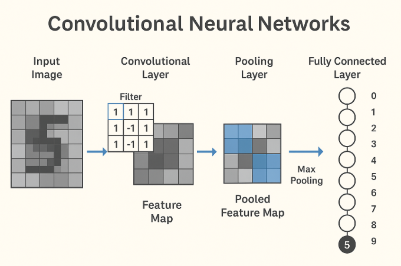

# Redes Neuronales Convolutivas


## Pregunta
Explícame cómo funcionan y cómo se entrenan las Redes Neuronales Convolutivas


## Respuesta
Las **Redes Neuronales Convolutivas (CNNs)** son un tipo especial de red neuronal diseñada específicamente para trabajar con datos que tienen una estructura en forma de cuadrícula, como las imágenes. Son ampliamente utilizadas en **visión por computadora**, por ejemplo, para reconocer objetos en fotografías.

---

## ¿Cómo Funcionan las CNNs?

### 1. **Estructura General**

Una CNN se compone principalmente de tres tipos de capas:

- **Capas Convolucionales**
- **Capas de Pooling (submuestreo)**
- **Capas Completamente Conectadas (Fully Connected)**

#### a. **Capa Convolucional**

Esta capa aplica filtros o **kernels** que "recorren" la imagen original (o las salidas de capas anteriores) detectando **características locales** como bordes, esquinas, texturas, etc.

- Por ejemplo, un filtro puede detectar bordes verticales en una imagen.
- Cada filtro genera un "mapa de características" o **feature map**.

#### b. **Capa de Pooling**

Reduce el tamaño del mapa de características para:

- Disminuir la cantidad de parámetros.
- Hacer la red más eficiente y evitar el sobreajuste.

El más común es el **Max Pooling**, que toma el valor máximo en una pequeña región (como 2x2).

#### c. **Capas Completamente Conectadas**

Después de varias capas convolucionales y de pooling, la salida se **aplana** y pasa por una red neuronal normal. Esta parte se encarga de hacer la **clasificación final** (por ejemplo, si una imagen es de un gato o un perro).

---

## ¿Cómo se Entrenan las CNNs?

El entrenamiento sigue un proceso similar al de otras redes neuronales, pero aplicado a estructuras convolucionales:

### 1. **Propagación Hacia Adelante (Forward Propagation)**

La imagen pasa por todas las capas, generando una predicción (por ejemplo, probabilidades para cada clase).

### 2. **Cálculo de la Pérdida**

Se compara la predicción con la **etiqueta real** usando una función de pérdida (como entropía cruzada).

### 3. **Propagación Hacia Atrás (Backpropagation)**

Se calculan los gradientes de error respecto a todos los parámetros (pesos del filtro) usando el **algoritmo de retropropagación**.

### 4. **Actualización de Pesos**

Los pesos se actualizan usando un **algoritmo de optimización** como el **descenso por gradiente** (por ejemplo, Adam o SGD), para que la red mejore sus predicciones en la próxima iteración.

---

## Ejemplo Ilustrativo

Supongamos que entrenamos una CNN para reconocer si hay un gato en una imagen:

1. La primera capa puede detectar bordes.
2. La segunda capa puede detectar formas como orejas o ojos.
3. Las capas finales reconocen la **combinación de estas formas** para decir si hay un gato.

---

## Conclusión

Las CNNs son potentes porque **capturan automáticamente características importantes** de una imagen sin necesidad de que un humano las defina manualmente. Gracias a su arquitectura, son más eficientes y precisas para tareas de visión por computadora que las redes neuronales tradicionales.


## Pregunta
Ejemplo en Python.


## Respuesta
Perfecto. A continuación, te muestro un ejemplo **paso a paso** de cómo funciona una CNN simple utilizando el conjunto de datos **MNIST**, que contiene imágenes de dígitos escritos a mano (0-9). Este ejemplo usa Python y la librería **Keras** (parte de TensorFlow).

---

## 🧠 Ejemplo Práctico: Clasificación de Dígitos con una CNN

### 1. **Importar Librerías**

```python
import tensorflow as tf
from tensorflow.keras import layers, models
import matplotlib.pyplot as plt
```

---

### 2. **Cargar y Preprocesar los Datos**

```python
# Cargar el dataset MNIST
mnist = tf.keras.datasets.mnist
(x_train, y_train), (x_test, y_test) = mnist.load_data()

# Normalizar los valores de píxeles a [0,1]
x_train = x_train / 255.0
x_test = x_test / 255.0

# Añadir una dimensión de canal (necesario para CNNs)
x_train = x_train.reshape(-1, 28, 28, 1)
x_test = x_test.reshape(-1, 28, 28, 1)
```

---

### 3. **Construir la CNN**

```python
model = models.Sequential([
    layers.Conv2D(32, (3, 3), activation='relu', input_shape=(28, 28, 1)),
    layers.MaxPooling2D((2, 2)),
    layers.Conv2D(64, (3, 3), activation='relu'),
    layers.MaxPooling2D((2, 2)),
    layers.Flatten(),
    layers.Dense(64, activation='relu'),
    layers.Dense(10, activation='softmax')  # 10 clases para dígitos 0-9
])
```

---

### 4. **Compilar y Entrenar el Modelo**

```python
model.compile(optimizer='adam',
              loss='sparse_categorical_crossentropy',
              metrics=['accuracy'])

model.fit(x_train, y_train, epochs=5, validation_data=(x_test, y_test))
```

---

### 5. **Evaluar y Visualizar Resultados**

```python
test_loss, test_acc = model.evaluate(x_test, y_test)
print(f"Precisión en el conjunto de prueba: {test_acc:.2f}")

# Mostrar algunas predicciones
import numpy as np

predictions = model.predict(x_test)
for i in range(5):
    plt.imshow(x_test[i].reshape(28, 28), cmap='gray')
    plt.title(f"Predicción: {np.argmax(predictions[i])}")
    plt.axis('off')
    plt.show()
```

---

## ¿Qué Hace Cada Parte?

- **Conv2D**: detecta patrones locales como bordes.
- **MaxPooling2D**: reduce el tamaño de los datos conservando la información importante.
- **Flatten + Dense**: transforma la información para hacer una clasificación.

---


