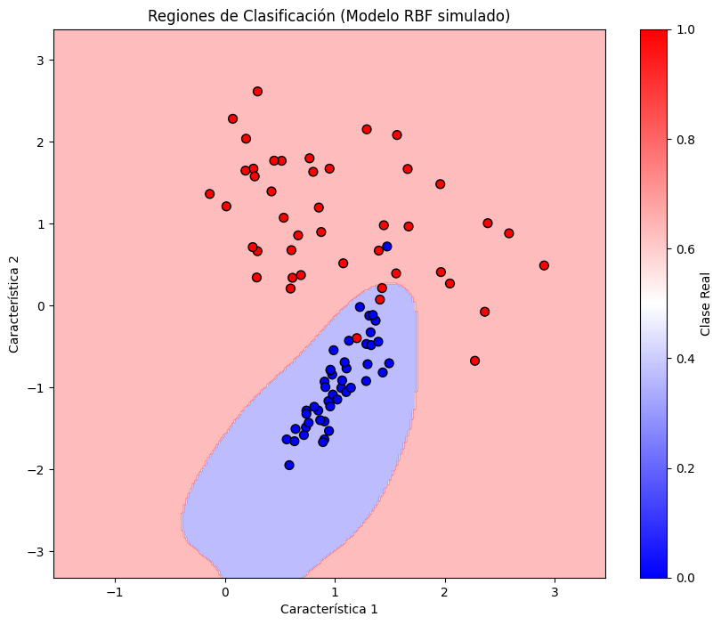

# Redes Neuronales de Base Radial

Conversión del archivo Redes Neuronales de Base Radial.mhtml. Se conserva el contenido de la conversación y su orden; las fórmulas se expresan en LaTeX y el código en bloques Markdown.

## 1. Pregunta

Explícame como funciona una Red Neuronal de Base Radial

## 1. Respuesta

Una **Red Neuronal de Base Radial (RBF, por sus siglas en inglés)** es un tipo de red neuronal artificial que se utiliza principalmente para tareas de **clasificación**, **regresión**, y **aproximación de funciones**. Es conocida por su simplicidad y eficacia en problemas donde los datos tienen estructuras espaciales claras.

------------------------------------------------------------------------

##### 🧠 ¿Qué es una Red Neuronal de Base Radial?

Una RBF es una red con **tres capas**:

1.  **Capa de entrada**: Recibe los datos.

2.  **Capa oculta**: Contiene neuronas con funciones de activación radial, comúnmente funciones **Gaussiana**.

3.  **Capa de salida**: Produce el resultado de la red (como una clase o un valor numérico).

------------------------------------------------------------------------

##### 🏗️ ¿Cómo funciona?

###### 1. **Capa de Entrada**

Cada nodo representa una característica (atributo) del vector de entrada.

###### 2. **Capa Oculta (RBFs)**

Aquí está la clave del modelo:

- Cada **neurona oculta** calcula la **distancia euclidiana** entre el vector de entrada y un **centro** (vector que representa una clase o patrón).

- Luego aplica una **función radial** como la Gaussiana:


$$
\phi(x) = \exp\left(-\frac{\|x - c\|^2}{2\sigma^2}\right)
$$


donde:

- $x$: vector de entrada

- $c$: centro de la función

- $\sigma$: ancho o "radio" de la función Gaussiana

Esto mide **cuánto se parece el dato de entrada al centro**. Cuanto más cerca esté, mayor será la salida de la función radial.

###### 3. **Capa de Salida**

Realiza una combinación lineal de las salidas de la capa oculta. En clasificación, la clase con mayor activación es la elegida.

------------------------------------------------------------------------

##### ⚙️ Entrenamiento

El entrenamiento de una RBF típicamente ocurre en dos fases:

1.  **Determinación de los centros**:

    - Se eligen mediante clustering (como **k-means**) o de forma aleatoria.

2.  **Ajuste de los pesos de salida**:

    - Se realiza mediante un método lineal (como mínimos cuadrados) porque la red se comporta linealmente en la salida.

------------------------------------------------------------------------

##### 📈 Aplicaciones

- Reconocimiento de patrones

- Clasificación de imágenes o señales

- Modelado de funciones no lineales

- Control adaptativo y predicción

------------------------------------------------------------------------

##### 🧩 Comparación con redes neuronales tradicionales

| Característica            | RBF                     | Red Neuronal Feedforward   |
|---------------------------|-------------------------|----------------------------|
| Capa oculta               | Funciones radiales      | Funciones sigmoides o ReLU |
| Entrenamiento             | Más rápido (en general) | Más lento, iterativo       |
| Interpretabilidad         | Más interpretable       | Menos interpretable        |
| Sensibilidad a parámetros | Alta (centros y sigmas) | Menor                      |

------------------------------------------------------------------------


## 2. Pregunta

Ejemplo en Python con visualizaciones.

## 2. Respuesta

A continuación se muestro un **ejemplo visual y de código sencillo en Python** usando `scikit-learn` para entender cómo funciona una Red Neuronal de Base Radial (RBF) aplicada a un problema de clasificación simple.

------------------------------------------------------------------------

##### 📊 Problema: Clasificación de dos clases en 2D

Imaginemos que tenemos dos tipos de puntos en un plano (dos clases), y queremos que la RBF los clasifique.

------------------------------------------------------------------------

##### 🧪 Código en Python


```python
import numpy as np
import matplotlib.pyplot as plt
from sklearn.datasets import make_classification
from sklearn.model_selection import train_test_split
from sklearn.metrics import accuracy_score
from sklearn.pipeline import Pipeline
from sklearn.preprocessing import StandardScaler
from sklearn.linear_model import RidgeClassifier
from sklearn.kernel_approximation import RBFSampler

# Crear datos sintéticos
X, y = make_classification(n_samples=300, n_features=2, n_redundant=0,
                           n_clusters_per_class=1, n_classes=2, random_state=42)

# Separar datos de entrenamiento y prueba
X_train, X_test, y_train, y_test = train_test_split(X, y, test_size=0.3, random_state=42)

# Crear una RBF simulada con RBFSampler + RidgeClassifier
model = Pipeline([
    ('scaler', StandardScaler()),
    ('rbf', RBFSampler(gamma=1.0, n_components=100, random_state=42)),
    ('classifier', RidgeClassifier())
])

# Entrenar modelo
model.fit(X_train, y_train)

# Evaluar
y_pred = model.predict(X_test)
print("Precisión:", accuracy_score(y_test, y_pred))

# Visualización
plt.figure(figsize=(8, 6))
plt.scatter(X_test[:, 0], X_test[:, 1], c=y_pred, cmap='bwr', alpha=0.6, edgecolors='k')
plt.title("Clasificación con Red Neuronal de Base Radial simulada")
plt.xlabel("Característica 1")
plt.ylabel("Característica 2")
plt.show()
```


------------------------------------------------------------------------

##### 🔍 ¿Qué hace este código?

1.  **Genera datos** para dos clases.

2.  **Simula una RBF** usando `RBFSampler`, que aproxima el comportamiento de una red RBF mediante una transformación del kernel.

3.  **Entrena un clasificador lineal** (`RidgeClassifier`) en el espacio transformado por la RBF.

4.  **Muestra una gráfica** de cómo clasifica los puntos.

------------------------------------------------------------------------

## 3. Pregunta

Ejemplo visual del resultado de aplicar una Red Neuronal de Base Radial.

## 3. Respuesta




Visualización del resultado de una red RBF simulada en un plano 2D y un ejemplo práctico en Python.

## 4. Pregunta

Profundización de cómo se entrena y cómo se eligen los parámetros de esta Red Neuronal

## 4. Respuesta

Entrenar una **Red Neuronal de Base Radial (RBF)** implica varios pasos clave. Aunque es más simple que las redes profundas, requiere decisiones cuidadosas sobre **centros**, **anchos (σ)** y **pesos de salida**. A continuación se explica cada aspecto con más detalle.

------------------------------------------------------------------------

##### 🧩 1. Elección de los **centros (c)**

Los centros determinan **dónde** se coloca cada función radial. Son esenciales porque cada centro actúa como un "prototipo" de una región de datos.

###### Métodos para elegir centros:

- **K-Means**: Método más común. Agrupa los datos y utiliza los centroides como centros de las funciones radiales.

- **Selección aleatoria**: Se eligen al azar algunos puntos del conjunto de entrenamiento como centros (rápido pero menos robusto).

- **Entrenamiento supervisado**: Algunos algoritmos ajustan los centros de forma adaptativa para minimizar el error (más costoso computacionalmente).

------------------------------------------------------------------------

##### 📏 2. Elección del **ancho (σ)**

El ancho (también llamado *spread* o *radio*) controla **la extensión de la función radial**. Si es muy grande, todas las funciones se superponen demasiado; si es muy pequeño, la red no generaliza bien.

###### Métodos comunes:

- **Fijo global**: Un solo valor σ para todas las funciones, por ejemplo:


$$
\sigma = \frac{d_{\max}}{\sqrt{2N}}
$$


donde $d_{\max}$ es la distancia máxima entre centros y $N$ es el número de centros.

- **Adaptativo por centro**: Cada centro tiene su propio σ, basado en la distancia a sus vecinos más cercanos.

------------------------------------------------------------------------

##### 🧠 3. Ajuste de **pesos de salida (w)**

Una vez transformado el conjunto de datos por las funciones radiales, el problema se vuelve **lineal**:


$$
y(x) = \sum_{i=1}^{N} w_i \phi_i(x)
$$


Aquí, $w_i$ son los pesos que se ajustan para minimizar el error entre las salidas $y(x)$ y las etiquetas reales.

###### Métodos:

- **Regresión lineal ordinaria** (mínimos cuadrados)

- **Ridge regression** (con regularización para evitar sobreajuste)

- **Pseudo-inversa** de la matriz de activaciones (en problemas pequeños)

------------------------------------------------------------------------

##### ⚖️ Balance entre bias y varianza

- **Muchos centros + σ pequeño**: bajo bias, alta varianza (riesgo de sobreajuste).

- **Pocos centros + σ grande**: alto bias, baja varianza (red poco expresiva).

La clave está en encontrar un equilibrio que permita **generalizar sin sobreajustar**.

------------------------------------------------------------------------

##### 📌 Ejemplo resumido del proceso completo

1.  **Entrenamiento**

    - Aplica K-means sobre los datos → Obtén centros.

    - Calcula σ adecuado para cada centro.

    - Aplica las funciones gaussianas a los datos → obtén matriz Φ.

    - Resuelve el sistema lineal: $W = (Φ^T Φ)^{-1} Φ^T y$

2.  **Predicción**

    - Para una nueva entrada, calcula las distancias a los centros.

    - Aplica funciones gaussianas → combinación lineal → salida.

------------------------------------------------------------------------
