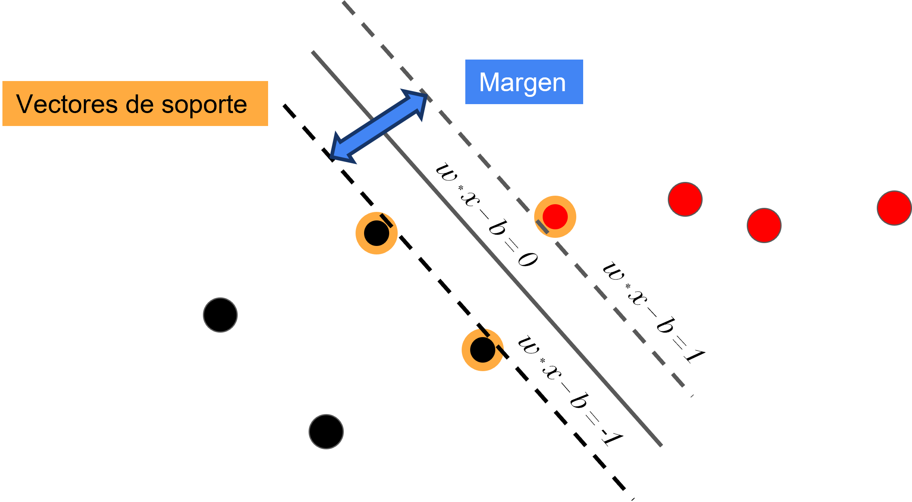
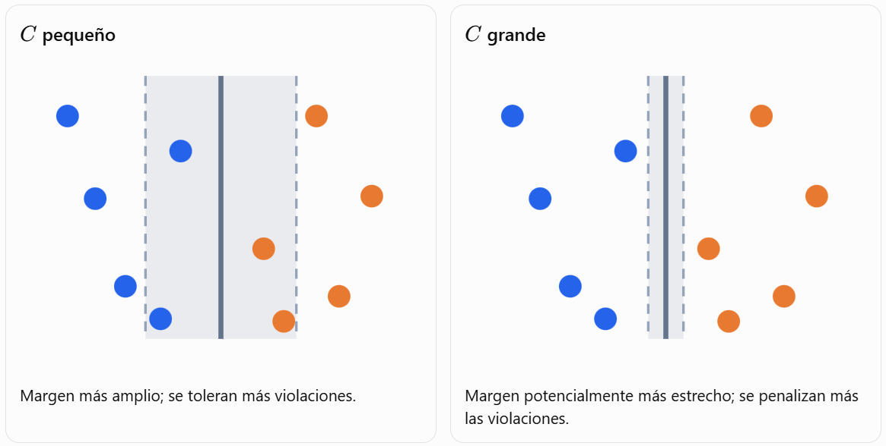
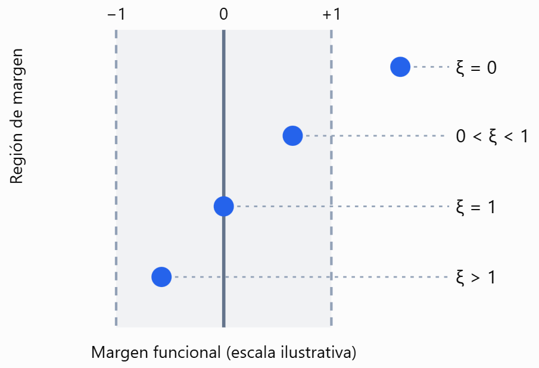

# Máquinas de Soporte Vectorial (SVM)

**Inteligencia Artificial — Universidad del Norte**  
**Eduardo Zurek, Ph.D.**

> Documento Markdown elaborado a partir de la presentación original. Se conservan las imágenes de las diapositivas y se transcribe el texto editable. Las ecuaciones incluidas en imágenes se presentan además en LaTeX cuando corresponde.

##  

Máquinas de Soporte Vectorial  
Inteligencia Artificial  
Universidad del Norte  
Eduardo Zurek, Ph.D.  

---

##  

¿Qué son las Máquinas de Soporte Vectorial?  
Una SVM es un algoritmo que busca encontrar el hiperplano óptimo que separa de la mejor forma posible las clases en un conjunto de datos. En un problema de clasificación binaria (dos clases), este hiperplano divide el espacio en dos partes, cada una correspondiente a una clase.  

---

##  

Conceptos Importantes  
Hiperplano: es una línea (en 2D), plano (en 3D), o una superficie (en dimensiones mayores) que divide los datos en clases.  
Margen: es la distancia entre el hiperplano y los puntos más cercanos de cada clase. La SVM busca maximizar este margen.  
Vectores de soporte: son los puntos de datos más cercanos al hiperplano. Son críticos para definir la posición y orientación del hiperplano.  
Clasificación lineal vs no lineal: si los datos no se pueden separar con una línea recta, se pueden transformar con funciones llamadas kernels que permiten encontrar un hiperplano en un espacio de mayor dimensión.  

---

##  

---

##  

Tipos de SVM  
  - SVM lineal: funciona bien cuando los datos son separables por una línea recta.
  - SVM con kernel: usa funciones matemáticas (como el kernel gaussiano o RBF) para manejar datos no linealmente separables.
Ventajas  
  - Funciona bien en espacios de alta dimensión.
  - Eficiente en casos donde el número de dimensiones es mayor al de muestras.
  - Robusta frente a sobreajuste en problemas bien configurados.
Desventajas  
  - Puede ser ineficiente con conjuntos de datos muy grandes.
  - Elegir el kernel y los parámetros adecuados puede ser complejo.
  - No proporciona directamente probabilidades como salida (aunque hay extensiones que sí lo hacen).

---

##   — ¿Qué es el margen?

El **margen** es la distancia entre el hiperplano de decisión y los vectores de soporte más cercanos. En clasificación lineal con clases perfectamente separables, el ancho total del margen es:

$$
M=\frac{2}{\|\mathbf{w}\|}
$$

### ¿Por qué minimizar $\|\mathbf{w}\|$?

El margen es inversamente proporcional a la norma (longitud) del vector de pesos $\mathbf{w}$:

- Si $\|\mathbf{w}\|$ es grande, el margen es pequeño.
- Si $\|\mathbf{w}\|$ es pequeño, el margen es grande.

Por tanto, para **maximizar el margen** y favorecer la generalización, es necesario **minimizar $\|\mathbf{w}\|$**.

---

##   — Optimización para maximizar el margen

Encontrar el hiperplano de margen máximo constituye un **problema de optimización**. Matemáticamente, el objetivo es maximizar el margen, inversamente proporcional a la norma del vector de pesos $\|\mathbf{w}\|$. Por ello, maximizar el margen equivale a minimizar $\|\mathbf{w}\|^2$.

El problema se formula mediante **restricciones** que aseguran que todos los puntos estén correctamente clasificados y se encuentren fuera del margen. La formulación aparece en la siguiente diapositiva.

---

##   — Formulación matemática del problema

**Minimizar:**

$$
\min_{\mathbf{w},b}\;\frac{1}{2}\|\mathbf{w}\|^2
$$

**Sujeto a:**

$$
y_i(\mathbf{w}\cdot\mathbf{x}_i-b)\geq 1,\qquad \forall i
$$

Donde:

- $\mathbf{w}$ es el vector normal al hiperplano.
- $b$ es el término de sesgo (*bias*).
- $\mathbf{x}_i$ es el vector de características del $i$-ésimo punto de datos.
- $y_i$ es la etiqueta de clase del $i$-ésimo punto de datos ($+1$ o $-1$).

---

##   — Multiplicadores de Lagrange y margen suave

Para resolver el problema de optimización con restricciones, se utiliza la técnica de los **multiplicadores de Lagrange**. Esto transforma el problema original (**primal**) en un problema **dual**, especialmente útil cuando se introducen kernels.

En situaciones reales, los datos no siempre son perfectamente separables linealmente. Para estos casos se introduce una **variable de holgura** ($\xi$) y un **parámetro de regularización** ($C$).

- La variable de holgura permite que algunos puntos estén dentro del margen o incluso en el lado incorrecto del hiperplano.
- El parámetro $C$ controla la penalización asociada a esas violaciones.

Este enfoque se conoce como **margen suave** (*soft margin*).

### Relación entre el parámetro $C$ y las variables de holgura

En una SVM, el parámetro **$C$** y las **variables de holgura $\xi_i$** están directamente relacionados, pero cumplen funciones diferentes:

- **$\xi_i$** mide cuánto viola la observación $i$ las restricciones del margen.
- **$C$** determina cuánto penaliza el algoritmo esas violaciones durante el entrenamiento.

Esta relación aparece explícitamente en la función objetivo de una SVM de margen suave (*soft-margin SVM*).

#### 1. Formulación matemática

La formulación de **margen duro** (*hard margin*) presentada anteriormente es:

$$
\min_{\mathbf{w},b}\frac{1}{2}\|\mathbf{w}\|^2
$$

Sujeto a:

$$
y_i(\mathbf{w}^{T}\mathbf{x}_i-b)\geq 1
$$

Exige que todas las observaciones estén correctamente clasificadas y fuera del margen. Cuando los datos no son perfectamente separables, introducimos una variable de holgura $\xi_i$ por observación:

$$
\boxed{\min_{\mathbf{w},b,\boldsymbol{\xi}}\frac{1}{2}\|\mathbf{w}\|^2+C\sum_{i=1}^{n}\xi_i}
$$

Sujeto a:

$$
y_i(\mathbf{w}^{T}\mathbf{x}_i-b)\geq 1-\xi_i
$$

$$
\xi_i\geq 0,\qquad i=1,\ldots,n
$$

La función objetivo contiene dos componentes:

| Componente | Expresión | Propósito |
|---|---|---|
| Regularización | $\frac12\|\mathbf{w}\|^2$ | Favorece un margen amplio. |
| Penalización | $C\sum_i\xi_i$ | Castiga las violaciones del margen. |

El algoritmo busca un equilibrio entre ambos objetivos.

#### 2. Interpretación de las variables de holgura

Definamos el **margen funcional** de una observación:

$$
m_i=y_i(\mathbf{w}^{T}\mathbf{x}_i-b)
$$

Para un hiperplano dado, la holgura mínima compatible con las restricciones es:

$$
\boxed{\xi_i=\max(0,1-m_i)}
$$

| Valor de $\xi_i$ | Interpretación |
|---|---|
| $\xi_i=0$ | Clasificación correcta, sobre el límite del margen o fuera de él. |
| $0<\xi_i<1$ | Clasificación correcta, pero dentro del margen. |
| $\xi_i=1$ | Observación situada sobre el hiperplano de decisión. |
| $\xi_i>1$ | Observación clasificada incorrectamente. |

**Importante:** una holgura positiva no implica necesariamente un error de clasificación; también puede indicar únicamente una violación del margen.

#### 3. Efecto del parámetro $C$

**Cuando $C$ es pequeño:**

- El término $C\sum_i\xi_i$ tiene menor peso relativo en la función objetivo.
- El optimizador puede aceptar mayores holguras si con ello reduce $\|\mathbf{w}\|^2$.
- Se favorece un margen potencialmente más amplio y se toleran más violaciones.

**Cuando $C$ es grande:**

- Las violaciones del margen resultan más costosas.
- El algoritmo tiende a reducirlas, incluso si necesita una norma de pesos mayor.
- El margen puede ser más estrecho y la tolerancia a violaciones menor.

| Aspecto | $C$ pequeño | $C$ grande |
|---|---|---|
| Penalización de holguras | Menor | Mayor |
| Tolerancia a violaciones del margen | Mayor | Menor |
| Margen resultante | Tiende a ser más amplio | Puede ser más estrecho |
| Riesgo práctico | Posible subajuste | Posible sobreajuste |

**Precisión:** cambiar $C$ también puede modificar la posición y la orientación del hiperplano. Aumentar $C$ no garantiza que disminuyan todos los errores individuales ni que mejore el desempeño sobre datos de validación.

En síntesis, **$C$ no fija directamente los valores de $\xi_i$**: las holguras se determinan durante la optimización junto con el hiperplano, mientras que $C$ establece el costo de permitirlas.

---

##   — Tipos de kernels y sus aplicaciones

Cuando los datos no pueden separarse mediante un hiperplano lineal en su espacio original, las SVM emplean el **truco del kernel** (*kernel trick*).

La idea consiste en representar los datos en un espacio de características de mayor dimensión, donde pueden ser linealmente separables. Las funciones kernel calculan el producto escalar de los vectores en ese espacio sin necesidad de realizar explícitamente la transformación, lo que puede ahorrar una cantidad considerable de cómputo.

Existen varios tipos de kernels y su elección depende de la estructura de los datos.

---

##   — Kernel lineal y kernel polinomial

### Kernel lineal

**Fórmula:**

$$
K(\mathbf{x}_i,\mathbf{x}_j)=\mathbf{x}_i^T\mathbf{x}_j
$$

**Aplicación:** se utiliza cuando los datos son linealmente separables. Es el kernel más simple y computacionalmente menos costoso. Constituye una buena primera opción para clasificación de texto o cuando el número de características es muy grande.

### Kernel polinomial

**Fórmula:**

$$
K(\mathbf{x}_i,\mathbf{x}_j)=(\gamma\mathbf{x}_i^T\mathbf{x}_j+r)^d
$$

**Aplicación:** resulta útil cuando la frontera de decisión es no lineal y de naturaleza polinómica. Deben ajustarse el grado $d$, el parámetro $\gamma$ (*gamma*) y el coeficiente $r$. Se menciona su uso en procesamiento de imágenes.

---

##   — Kernel RBF y kernel sigmoide

### Kernel de función de base radial (RBF) o gaussiano

**Fórmula:**

$$
K(\mathbf{x}_i,\mathbf{x}_j)=\exp\left(-\gamma\|\mathbf{x}_i-\mathbf{x}_j\|^2\right)
$$

**Aplicación:** es uno de los kernels más populares y flexibles; permite manejar relaciones complejas y no lineales. Es una opción cuando no se conoce previamente la distribución de los datos.

El parámetro $\gamma$ determina el alcance de la influencia de cada ejemplo de entrenamiento:

- **$\gamma$ bajo:** influencia de mayor alcance.
- **$\gamma$ alto:** influencia más localizada.

### Kernel sigmoide

**Fórmula:**

$$
K(\mathbf{x}_i,\mathbf{x}_j)=\tanh(\gamma\mathbf{x}_i^T\mathbf{x}_j+r)
$$

**Aplicación:** presenta un comportamiento similar a la función de activación sigmoide de las redes neuronales. Se plantea para fronteras de decisión con forma de «S». En la práctica, con frecuencia es superado por el kernel RBF; la presentación menciona aplicaciones en bioinformática.

---

##   — Parámetro $C$: coste o regularización

**Función:** controla el equilibrio entre maximizar el margen y minimizar los errores de clasificación.

**Interpretación:**

- **$C$ grande:** penaliza fuertemente los errores; menor tolerancia a valores atípicos (*outliers*).
- **$C$ pequeño:** permite más errores; mayor tolerancia a valores atípicos.

**Intuición:** al reducir $C$, se permite que algunos puntos queden dentro del margen o incluso sean clasificados incorrectamente. Esto resulta útil cuando se sospecha que los datos contienen ruido o valores atípicos.

---

##   — Variables de holgura (*slack variables*)

**Función:** permiten que determinados puntos queden dentro del margen o sean clasificados incorrectamente, especialmente en la versión **soft-margin** de SVM.

**Aplicación:** las variables de holgura no se ajustan directamente como hiperparámetros; están controladas implícitamente por $C$. Cuanto menor sea $C$, mayor será la tolerancia a las violaciones del margen y a los errores de clasificación.

---

##   — Función kernel y valores atípicos

**Función:** transforma conceptualmente los datos a un espacio de características de mayor dimensión en el que pueden separarse mejor.

**Impacto en outliers:**

- Algunos kernels, como **RBF**, pueden ajustarse mediante $\gamma$ para suavizar el efecto de puntos extremos.
- Un $\gamma$ demasiado grande puede provocar un ajuste excesivo a los datos, reduciendo la tolerancia a valores atípicos.

---

##   — Combinación sugerida para tolerancia a outliers

Si el conjunto de datos contiene muchos valores atípicos, la presentación propone:

| Parámetro | Valor sugerido | Justificación |
|---|---|---|
| $C$ | Bajo | Permite errores y un margen mayor. |
| Kernel | RBF o polinomial | Capta relaciones más complejas. |
| $\gamma$ (*gamma*) | Bajo | Evita sobreajuste a puntos individuales. |

---

##   — Criterios para elegir una SVM: separabilidad

Elegir el mejor modelo SVM para un conjunto de datos específico requiere combinar **criterios teóricos, empíricos y prácticos**. El objetivo es obtener buen rendimiento tanto en entrenamiento como en generalización.

### 1. Separabilidad de las clases

**¿Por qué importa?** Ayuda a decidir entre un modelo lineal y uno no lineal (con kernel).

**Cómo evaluarla:**

- Visualizar los datos si tienen dos o tres dimensiones.
- Si las clases parecen separables mediante una línea recta, considerar `kernel='linear'`.
- Si las clases están entremezcladas o presentan formas curvas, considerar `kernel='rbf'` o `kernel='poly'`.

---

##   — Elección del kernel

| Kernel | Recomendado cuando… |
|---|---|
| Lineal | Alta dimensionalidad y muchas variables irrelevantes. |
| Polinomial | Las relaciones entre atributos son no lineales, pero suaves. |
| RBF (gaussiano) | Existen relaciones complejas o desconocidas entre las variables. |
| Sigmoidal | Se usa raramente; presenta similitudes con una red neuronal. |

---

##   — Ajuste del parámetro $C$

**¿Por qué importa?** Controla la rigidez del modelo frente a los errores de clasificación.

**Criterios propuestos:**

- Si el conjunto de datos contiene ruido o *outliers*, considerar un **$C$ bajo**.
- Si el conjunto de datos está limpio y bien etiquetado, considerar un **$C$ más alto** para penalizar más los errores.

---

##   — Ajuste del parámetro $\gamma$

Este parámetro se emplea en kernels no lineales como **RBF**.

**¿Por qué importa?** Define la influencia de cada ejemplo sobre la frontera de decisión.

| Valor de $\gamma$ | Resultado |
|---|---|
| Bajo | Modelo más general, con curvas suaves. |
| Alto | Modelo más específico, con curvas ajustadas. |

---

##   — Validación cruzada (*cross-validation*)

**¿Por qué importa?** Permite estimar el rendimiento del modelo y orientar la selección de hiperparámetros sin depender exclusivamente del rendimiento en entrenamiento.

**Técnica recomendada:**

- **K-Fold Cross-Validation**, comúnmente con $K=5$ o $K=10$.
- Evaluar diferentes combinaciones de parámetros para elegir las más adecuadas.

---

##   — Métricas de rendimiento (I)

Para evaluar una SVM, especialmente con clases desbalanceadas o datos ruidosos, **no basta con medir la exactitud global**. Es importante utilizar varias métricas.

### a. Accuracy (exactitud global)

- Mide el porcentaje de predicciones correctas.
- Es útil cuando las clases están balanceadas.

### b. Precision (precisión)

- Indica qué proporción de las predicciones positivas fueron realmente correctas.
- Es importante cuando los **falsos positivos** son costosos.

### c. Recall (sensibilidad)

- Indica qué proporción de los casos positivos reales fueron correctamente identificados.
- Es importante cuando los **falsos negativos** son inaceptables.

---

##   — Métricas de rendimiento (II)

### d. F1-Score

Es la **media armónica** entre *precision* y *recall*:

$$
F_1=2\cdot\frac{\mathrm{Precision}\cdot\mathrm{Recall}}{\mathrm{Precision}+\mathrm{Recall}}
$$

- Útil cuando se necesita un equilibrio entre precisión y sensibilidad.
- Especialmente relevante en problemas con clases desbalanceadas.

### e. Curva ROC y AUC

- La curva **ROC** muestra la relación entre la tasa de verdaderos positivos (**TPR**, *recall*) y la tasa de falsos positivos (**FPR**).
- El **AUC** resume el área bajo la curva ROC. En general, cuanto más próximo a 1, mejor es la capacidad de discriminación.

---

##   — Dimensionalidad y tamaño del conjunto de datos

### 7. Dimensionalidad del dataset

- Con muchas características, SVM puede ser muy eficaz, especialmente con `kernel='linear'`.
- Si las variables son redundantes o ruidosas, conviene considerar reducción de dimensionalidad, por ejemplo **PCA**, antes del entrenamiento.

### 8. Tamaño del dataset

- **Conjuntos pequeños y medianos:** SVM suele funcionar muy bien.
- **Conjuntos muy grandes:** SVM puede volverse lento; considerar variantes como `LinearSVC` u otros modelos más escalables.

---

##   — Revisión de conceptos clave

### 1. Accuracy (exactitud o precisión global)

Es el porcentaje de predicciones correctas sobre el total de predicciones:

$$
\mathrm{Accuracy}=\frac{TP+TN}{TP+TN+FP+FN}
$$

Donde:

- **TP:** verdaderos positivos.
- **TN:** verdaderos negativos.
- **FP:** falsos positivos.
- **FN:** falsos negativos.

Es útil cuando las clases están balanceadas, pero puede ser engañosa cuando existe desbalance.

### 2. Precision (precisión)

Proporción de predicciones positivas que realmente son correctas:

$$
\mathrm{Precision}=\frac{TP}{TP+FP}
$$

Es útil cuando el costo de los falsos positivos es alto; por ejemplo, un diagnóstico positivo falso.

### 3. Recall (sensibilidad o exhaustividad)

Proporción de positivos reales que el modelo identifica correctamente:

$$
\mathrm{Recall}=\frac{TP}{TP+FN}
$$

Es importante cuando se desea minimizar los falsos negativos; por ejemplo, en detección de enfermedades o fraudes.

---

## Material gráfico original

Se conserva la ilustración del hiperplano de la   en su ubicación original. Las imágenes de las diapositivas 6 a 26, cuyo contenido ha sido transcrito a texto editable, se incluyen en la carpeta `SVM_assets/` del paquete ZIP para consulta y comparación con la presentación.
